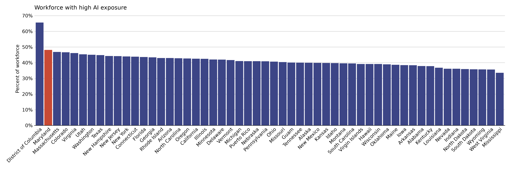
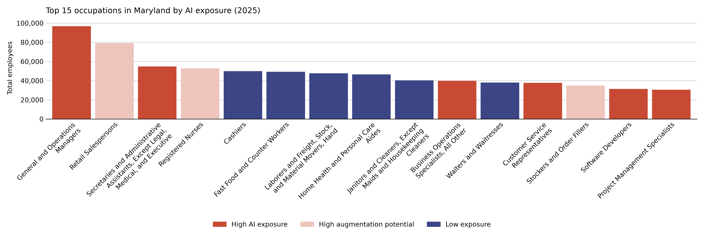
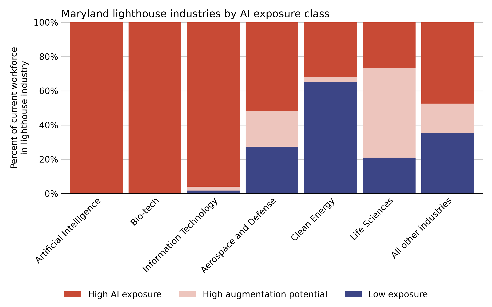

# Maryland Workforce AI Impact Analysis

> **Disclaimer:** This repository is intended as an investigation into using AI as a research tool, and is presented for educational purposes. The results do not reflect the administration position.

A preliminary investigation into how AI might affect Maryland's workforce along BLS occupation codes

## Methodology

First, occupation titles and the total employment in that occupation per state for 2025 were downloaded from the [BLS May 2025 State Occupational Employment and Wage Estimates](https://www.bls.gov/oes/special-requests/oesm25st.zip).

All LLM steps below were run with Claude Haiku 5.5 (`us.anthropic.claude-haiku-5-5`) on AWS Bedrock in November 2026, using structured (JSON schema) outputs. The code also supports Gemini (`gemini-3.8-flash`) and OpenAI (`gpt-6-luna`).

Second, a system prompt was designed in order to disaggregate each occupation into a list of associated daily tasks. For each occupation, an LLM was tasked with enumerating each of those tasks. The enumeration system prompt is as follows:

> For the cross-industry occupation title given by the user, please enumerate a full list of reasonable tasks that a person in that occupation would need to perform on a daily basis. Consider the entire spectrum of that individual's duties and responsibilities, both online (if applicable) and in person, in formulating the tasks. Please respond only with valid JSON in the specified format.

Lastly, a system prompt was designed in order to rate each occupation and task by the ability for an AI to complete it. It was important in the prompt to emphasize the legal, physical, and emotional requirements of each task, otherwise the LLM tended to over-estimate the ability for AI to complete it. Because an LLM's sense of what AI can do is frozen at its training cutoff, the prompt also includes a short summary of published evidence on agentic AI capabilities as of November 2026 (see [References](#references)). The capability context draws on the following sources:

- **Task time horizons:** METR's time-horizon measurements of frontier agents on software tasks, including the 50% and 80% reliability horizons and their roughly four-month doubling time since 2023 ([METR, 2026](#references)).
- **End-to-end and long-horizon work:** the Remote Labor Index of real freelance projects ([Mazeika et al., 2025](#references)), OSWorld 2.0 multi-application computer workflows ([Yuan et al., 2026](#references)), and Epoch AI's in-house automation trial ([Hong & Burnham, 2026](#references)).
- **Professional-quality digital work:** GDPval ([Patwardhan et al., 2025](#references)) and the Stanford AI Index ([Stanford HAI, 2026](#references)).
- **Observed use and labor-market evidence:** the Anthropic Economic Index ([Appel et al., 2026](#references); [Massenkoff et al., 2026](#references)), observed exposure and early employment effects ([Massenkoff & McCrory, 2026](#references); [Brynjolfsson et al., 2026](#references)), and agentic coding studies ([Hitzig et al., 2026](#references); [Becker et al., 2025](#references)).
- **Physical and embodied AI:** robot task feasibility ([Legate-Yang & Massenkoff, 2026](#references)), industrial and humanoid robot deployment ([IFR, 2026](#references)), and driverless vehicle operations ([Waymo, 2026](#references)).

The rating system prompt is as follows:

> For the cross-industry occupation title and specific task given by the user, rate the task's exposure to AI automation from 1-5.
> The ratings have the following interpretations:
> - 1: AI cannot perform the task at all
> - 2: AI can perform the task with assistance from a human operator
> - 3: AI can perform the task as well as an average human
> - 4: AI can perform the task as well as an expert human
> - 5: AI can perform the task better than an expert human
>
> Consider the entire spectrum of that occupation's duties and responsibilities, both online (if applicable) and in person, in formulating the ratings. Also consider the legal, physical, and emotional requirements of the task. Most tasks that require a physical presence should be rated 1; rate a physical task 2 only if robots already perform it in comparable structured real-world settings. Base your rating on the current state of AI described below rather than on assumptions about earlier or future systems.
>
> Capability context (as of November 2026): AI agents can now autonomously carry out many well-specified digital tasks, such as coding, data analysis, document drafting, research synthesis, and routine software operation, often at or near the quality of experienced professionals. Independent measurements from early 2026 show frontier agents completing software tasks that take human experts roughly 6-12 hours with 50% reliability, but only about 1-3 hours with 80% reliability; this horizon has doubled roughly every four months since 2023. Reliability drops as tasks become longer, more open-ended, or less clearly specified. On real end-to-end freelance projects, the best agents produce client-acceptable work for only about one in five projects, and on long multi-application computer workflows they fully succeed about 20% of the time. Agents still miss implicit standards, make unflagged errors, and generally need human review. Tasks that require legal accountability, professional licensure, sustained interpersonal trust, or emotional care remain mainly human. Physical automation is growing but concentrated in structured settings: factory and warehouse robots, robot-assisted surgery, and driverless taxis in a few U.S. cities. General-purpose humanoid robots remain at pilot scale, and most tasks needing dexterous manipulation in unstructured environments cannot yet be performed by robots.
>
> Please respond only with valid JSON in the specified format.

When aggregating the task ratings by occupation, certain thresholds were set to establish categories of AI exposure:
- **High AI exposure**: Occupations for which 50% or more of their tasks could be performed by AI at average human level or better.
- **High augmentation potential**: Occupations where less than 50% of the tasks could be performed by the AI at the average human level, but 50% or more of the tasks could be assisted by AI.
- **Low exposure**: Occupations where AI could perform or assist with less than 50% of tasks.

These classes follow the task-based approach to occupational exposure, which breaks an occupation into tasks and measures the share of tasks AI could perform ([Eloundou et al., 2024](#references)). The 50% cutoff matches the share of tasks Eloundou et al. use to report highly exposed workers. It is also close in spirit to the ILO's 2025 index, which places an occupation in its top exposure gradient when its mean task score is at least 0.6 on a 0-1 scale and the scores are consistent across tasks, so that most tasks score above the midpoint ([Gmyrek et al., 2025](#references)). The distinction behind the middle class above comes from the ILO's 2023 index, which separated occupations with *automation* potential from those with *augmentation* potential ([Gmyrek, Berg & Bescond, 2023](#references)). The 2025 update replaced that split with a spectrum of exposure gradients, and notes that its lower gradients align closely with the earlier notion of augmentation.

Exposure measures what AI is technically capable of, not predicted job loss. As Eloundou et al. note, "technical feasibility does not guarantee labor productivity or automation outcomes." Whether exposed tasks are actually automated depends on cost, regulation, organizational change, and demand. Early labor-market studies find effects concentrated among young workers in exposed occupations, not across the workforce as a whole ([Brynjolfsson et al., 2026](#references); [Massenkoff & McCrory, 2026](#references)).

## Results

### Tasks

From an initial 829 occupation titles, the task enumeration prompt elicited a total of 23,907 daily tasks (16 to 49 per occupation). See below for an example from the task list for **Chief Executives**, with ratings:

| Rating | Task |
|---|---|
| 4 | Review daily operational reports and key performance indicators to monitor company health and progress |
| 4 | Stay informed through reading industry reports, market analyses, and internal briefings |
| 3 | Review legal documents, contracts, and regulatory filings requiring executive signature |
| 2 | Review and approve major financial decisions, budgets, capital expenditures, and financial statements |
| 2 | Make high-stakes decisions on mergers, acquisitions, partnerships, and market expansion |
| 2 | Review and respond to critical emails, messages, and escalated issues from senior leaders and stakeholders |
| 1 | Deliver public speeches, presentations, or town hall addresses to employees and external audiences |
| 1 | Participate in industry associations, civic, and networking events to build the company's reputation |
| 1 | Travel to company locations, facilities, and key markets to conduct site visits and meet local teams |

Monitoring and synthesizing information scores a 4, meaning an AI can do it as well as an expert. Tasks that require a public presence, relationship building, or travel score a 1. Most Chief Executive tasks (17 of 26) scored a 2, meaning AI can perform them only with assistance from a human operator. These are tasks such as approving budgets, deciding on mergers, and responding to escalated issues, where AI can prepare the analysis or a draft but a human must make the decision and be accountable for it. Across all tasks, 35% were rated 1, 23% were rated 2, 22% were rated 3, 20% were rated 4, and fewer than 0.1% were rated 5.

### Most exposed occupations

The occupations that scored the highest in the above rating system are:

- Credit Authorizers, Checkers, and Clerks (average task score of 3.9)
- Telemarketers (average task score of 3.9)
- Bookkeeping, Accounting, and Auditing Clerks (average task score of 3.8)
- Web Developers (average task score of 3.8)
- Insurance Claims and Policy Processing Clerks (average task score of 3.8)

These occupations, along with scoring highly in the average of their tasks, were all classified as "High AI exposure." Overall, 330 occupations were classified as high AI exposure, 245 as high augmentation potential, and 254 as low exposure.

### Least exposed occupations

No occupation had a mean score of 1 across all of its tasks. The ten lowest-scoring occupations were:

- Continuous Mining Machine Operators (1.13)
- Fallers (1.15)
- Gambling Dealers (1.15)
- Construction Laborers (1.16)
- Dishwashers (1.18)
- Helpers -- Extraction Workers (1.20)
- Sailors and Marine Oilers (1.21)
- Building Cleaning Workers, All Other (1.21)
- Underground Mining Machine Operators, All Other (1.23)
- Helpers -- Roofers (1.24)

Most of the tasks in these occupations are physical. Their scores are slightly above 1 because the longer task lists include some recordkeeping and planning tasks, and because the prompt now allows a 2 for physical tasks that robots already perform in structured settings.

### National rankings

Maryland has the second-highest AI exposure among all US states, districts, and territories, with 48.1% of its current workforce in occupations with high AI exposure. Only the District of Columbia (65.6%) ranks higher. Massachusetts (46.9%), Colorado (46.6%), and Virginia (46.1%) follow.



### Sensitivity to the exposure threshold

The 50% cutoff for high AI exposure is a convention, not a measured tipping point. The literature uses a range of cutoffs, and they are not always on the same scale. For example, the widely cited 70% cutoff of [Frey and Osborne (2017)](#references) is a probability that a whole job is automatable, not a share of tasks. The table below shows how the results change when more of an occupation's tasks must be rated 3 or higher (AI performs at average human level or better) for it to count as highly exposed. Raising the cutoff only moves occupations from high AI exposure to high augmentation potential; the low exposure class is unchanged.

| Share of tasks rated 3+ | Occupations with high AI exposure | Maryland workforce with high AI exposure | Maryland rank (of 54) | All areas, pooled | District of Columbia |
|---|---|---|---|---|---|
| **50% (headline)** | 330 | 48.1% | 2 | 42.4% | 65.6% |
| 60% | 230 | 40.3% | 2 | 35.1% | 60.7% |
| 67% | 188 | 33.4% | 4 | 30.0% | 47.5% |
| 70% | 161 | 30.5% | 4 | 27.0% | 42.6% |
| 75% | 146 | 29.7% | 4 | 26.1% | 41.4% |
| 80% | 113 | 24.3% | 5 | 21.6% | 33.2% |

The share of the workforce with high AI exposure depends heavily on the cutoff: Maryland's share falls from 48.1% at 50% to 30.5% at 70%. Its ranking is more stable but not fixed. Maryland is second behind the District of Columbia up to a 60% cutoff, and falls to fourth (behind the District of Columbia, Colorado, and Virginia) at 67% and above. At every cutoff, Maryland's share is above the pooled share for all areas, by between 2.7 and 5.7 percentage points. Tomlinson et al. make a similar point about their own AI applicability measure: its absolute scores "depend strongly on the threshold," while relative comparisons between occupations are robust ([Tomlinson et al., 2025](#references)). The full table, including the top five areas at each cutoff, is in [`output/threshold_sensitivity.csv`](output/threshold_sensitivity.csv).

### Top occupations in Maryland

Of the 15 top occupations in Maryland by total employment, 6 have high AI exposure and 3 have high augmentation potential. The top occupation in Maryland is "General and Operations Managers," with a total employment of 96,740. This occupation has high AI exposure because 66% of its tasks can be performed by AI at the level of an average human or better. Those tasks rated most likely to be performed by AI include: `Review daily operational reports covering production, sales, staffing, and financial performance`, `Monitor key performance indicators and dashboards to identify deviations from targets`, and `Review and approve budgets, expenditures, purchase orders, and invoices`. The only General and Operations Manager task that could not be performed by AI at all was `Inspect facilities and work areas to verify safety, cleanliness, and quality standards are met`.



### Lighthouse industries

Some priority and emerging sectors in Maryland are among the most exposed to AI. Of the starting 829 occupation titles, 198 were identified as being related to these lighthouse industries.

- Aerospace and Defense - 37 occupations
- Artificial Intelligence - 1 occupation
- Bio-tech - 2 occupations
- Clean Energy - 22 occupations
- Information Technology - 29 occupations
- Life Sciences - 107 occupations

Artificial Intelligence ("Data Scientists") and Bio-tech ("Bioengineers and Biomedical Engineers" and "Biological Scientists, All Other") are each made up of very few occupations, and all of Maryland's workforce in them has high AI exposure. Information Technology came next, with 95.9% of Maryland's current workforce in that sector belonging to occupations with high AI exposure. Of all of these sectors, Clean Energy was the least exposed, with 65.1% of Maryland's current workforce in that sector belonging to occupations with low exposure.



### Changes from the previous (2025) analysis

The previous version of this analysis used BLS May 2023 data, `gpt-4o-mini`, and a rating prompt without the capability context. Compared with that version:

- Maryland's share of the workforce in occupations with high AI exposure (called "high automation risk" in the previous version) rose from 39.6% to 48.1%. It still ranks second, behind the District of Columbia (up from 55.4% to 65.6%).
- The number of occupations with high AI exposure rose from 222 to 330.
- The new model listed more than twice as many tasks per occupation (23,907 vs. 10,370), and assigned more occupations to lighthouse industries (198 vs. 138). The lighthouse industry results therefore reflect both the new classification and the new ratings.

Because the model, the task lists, the prompt, and the BLS data all changed at once, these differences should not be read as a measured change in AI capability over time.

## Installation (Linux / WSL)
```
cd python
python3 -m venv venv-linux
./venv-linux/bin/pip install -r requirements.txt
```

Copy `.env-example` to `python/.env` and fill it in. For Claude on Bedrock, set `AWS_PROFILE` to your AWS SSO profile and sign in before long runs:
```
aws sso login --profile bedrock
```
If the SSO token expires during a run, the scripts pause and retry every 60 seconds until you sign in again. `GEMINI_API_KEY` / `OPENAI_API_KEY` are only needed for `-m gemini` / `-m gpt`.

## Running the analysis
From the `python` directory:
```
./venv-linux/bin/python process_bls.py                     # BLS workbook -> occupation titles
./venv-linux/bin/python classify_industries.py -m claude   # lighthouse industry labels
./venv-linux/bin/python generate_tasks.py -m claude        # daily tasks per occupation
./venv-linux/bin/python rate_tasks.py -m claude            # 1-5 AI exposure ratings
./venv-linux/bin/python process_output.py                  # aggregates, charts, README stats
```
`-m` accepts `claude` (default), `gemini`, or `gpt`. `-w N` sets the number of concurrent requests (defaults: 64 for Claude, 16 for GPT, 1 for the Gemini free tier). Model IDs and reasoning effort can be overridden in `.env` (see `.env-example`).

## References

Sources for the exposure classes and for the capability context in the rating prompt:

- Appel, R., Massenkoff, M., McCrory, P., McCain, M., Heller, R., Neylon, T., & Tamkin, A. (2026, January 15). Anthropic Economic Index report: Economic primitives. Anthropic. https://www.anthropic.com/research/anthropic-economic-index-january-2026-report
- Becker, J., Rush, N., Barnes, E., & Rein, D. (2025, July 12). Measuring the Impact of Early-2025 AI on Experienced Open-Source Developer Productivity. arXiv:2507.09089. https://arxiv.org/abs/2507.09089
- Brynjolfsson, E., Chandar, B., & Chen, R. (2025; rev. 2026, August 12). Canaries in the Coal Mine? Six Facts about the Recent Employment Effects of Artificial Intelligence. Stanford Digital Economy Lab. https://digitaleconomy.stanford.edu/publications/canaries-in-the-coal-mine/
- Eloundou, T., Manning, S., Mishkin, P., & Rock, D. (2024). GPTs are GPTs: Labor market impact potential of LLMs. *Science*, 384(6702), 1306-1308. https://doi.org/10.1126/science.adj0998 (working paper: arXiv:2303.10130, https://arxiv.org/abs/2303.10130)
- Frey, C. B., & Osborne, M. A. (2017). The future of employment: How susceptible are jobs to computerisation? *Technological Forecasting and Social Change*, 114, 254-280. https://doi.org/10.1016/j.techfore.2016.08.019 (2013 working paper: https://oms-www.files.svdcdn.com/production/downloads/academic/The_Future_of_Employment.pdf)
- Gmyrek, P., Berg, J., & Bescond, D. (2023, August). Generative AI and Jobs: A Global Analysis of Potential Effects on Job Quantity and Quality (ILO Working Paper 96). International Labour Organization. https://doi.org/10.54394/FHEM8239
- Gmyrek, P., Berg, J., Kamiński, K., Konopczyński, F., Ładna, A., Nafradi, B., Rosłaniec, K., & Troszyński, M. (2025, May). Generative AI and Jobs: A Refined Global Index of Occupational Exposure (ILO Working Paper 140). International Labour Organization. https://doi.org/10.54394/HETP0387
- Hitzig, Z., Massenkoff, M., Lyubich, E., Zhang, S., Heller, R., & McCrory, P. (2026, June 16). Agentic coding and persistent returns to expertise. Anthropic. https://www.anthropic.com/research/claude-code-expertise
- Hong, K., & Burnham, G. (2026, October 8). Can AI automate Epoch? Epoch AI. https://epoch.ai/publications/can-ai-automate-epoch
- International Federation of Robotics (2026, September). World Robotics 2026: industrial robots and service robots press releases. https://ifr.org/news
- Legate-Yang, R., & Massenkoff, M. (2026, September 30). What work can robots do? Anthropic. https://www.anthropic.com/research/what-work-can-robots-do
- Massenkoff, M., & McCrory, P. (2026, March 5). Labor market impacts of AI: A new measure and early evidence. Anthropic. https://www.anthropic.com/research/labor-market-impacts
- Massenkoff, M., Lyubich, E., McCrory, P., Appel, R., & Heller, R. (2026, March 24). Anthropic Economic Index report: Learning curves. Anthropic. https://www.anthropic.com/research/economic-index-march-2026-report
- Mazeika, M., et al. (2025, October 30). Remote Labor Index: Measuring AI Automation of Remote Work. arXiv:2510.26787. https://arxiv.org/abs/2510.26787 ; leaderboard: https://labs.scale.com/leaderboard/rli (accessed 2026-11-05)
- METR (2026). Task-Completion Time Horizons of Frontier AI Models (Time Horizon 1.1; last updated September 8, 2026). https://metr.org/time-horizons/ ; raw results: https://metr.org/assets/benchmark_results_1_1.yaml (accessed 2026-11-05)
- Patwardhan, T., et al. (2025, October 5). GDPval: Evaluating AI Model Performance on Real-World Economically Valuable Tasks. arXiv:2510.04374. https://arxiv.org/abs/2510.04374
- Stanford HAI (2026). The 2026 AI Index Report. Stanford Institute for Human-Centered Artificial Intelligence. https://hai.stanford.edu/ai-index/2026-ai-index-report
- Tomlinson, K., Jaffe, S., Wang, W., Counts, S., & Suri, S. (2025; rev. 2026, October 23). Working with AI: Measuring the Applicability of Generative AI to Occupations. arXiv:2507.07935. https://arxiv.org/abs/2507.07935
- Waymo (2026). Safety Impact (data through June 2026). https://waymo.com/safety/impact/
- Yuan, M., Zhou, Z., Xiong, X., et al. (2026, June 28). OSWorld 2.0: Benchmarking Computer Use Agents on Long-Horizon Real-World Tasks. arXiv:2606.29537. https://arxiv.org/abs/2606.29537 ; project page: https://osworld-v2.xlang.ai/
